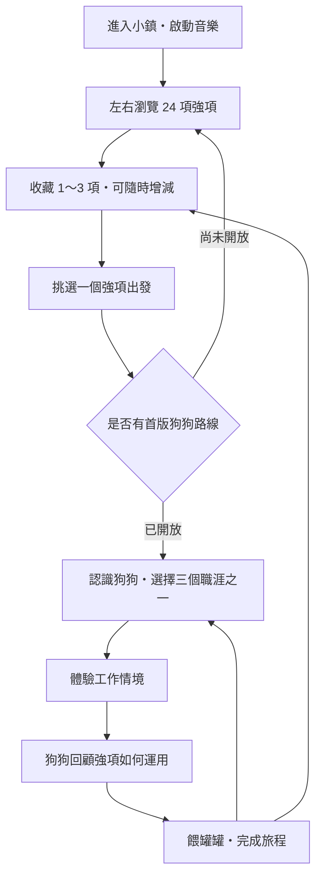

# Pawtopia｜汪汪職涯小鎮

[開啟遊戲](https://siangyin-hung.github.io/pawtopia/)

這一版是可操作的 RPG 體驗樣板。目標是讓玩家認識自己的強項，看見同一強項如何用於不同工作。職涯連結用於探索，不是測驗結果或職業適配判定。

公開版 `index.html` 已內嵌圖片、樣式和程式，可單獨下載開啟。`pawtopia-source.zip` 包含分檔原始碼與素材；解壓後執行 `python3 scripts/build.py` 可重新產生 `publish/` 發布檔。

- 24 項 VIA 強項逐幕瀏覽，可自選強項。首版有六個強項對應狗狗。
- 每隻狗的岔路有三棟可進入的建築，合計 18 條路線。兩段職場情境依序觀看，完成可餵罐罐並點亮該路。
- 全畫面場景由獨立的遊戲圖層組成。小旅人、六隻夥伴及村長有獨立角色圖，場景上可見待機動畫與浮動對話框。18 條職涯各有獨立背景。兩張原圖留在 `assets/` 作為美術參考。
- `data/strengths.js` 存放強項及暖暖的教育訓練長版腳本，`data/routes.js` 存放六隻狗和職涯情境草稿。
- 強項分類參考 [VIA Institute on Character](https://www.viacharacter.org/character-strengths)。職務參考 [台灣就業通 Jobooks](https://jobooks.taiwanjobs.gov.tw/) 和 [勞動部 iCAP](https://icap.wda.gov.tw/)。故事為虛構情境。

## 場景實景參考

遊戲背景是重新繪製的虛構場景。查找資料時參考台灣工作空間公開照片、設備和工作動線。

- 教育訓練的座位、投影與講桌見[桃園市中壢地政事務所新人訓練照片](https://www.zhongli-land.tycg.gov.tw/News_Content.aspx?n=17179&s=1239430&sms=18528)。客服工作參考[中華電信的多管道客服流程](https://www.cht.com.tw/zh-tw/home/cht/esg/customer-care/customer-relationship/customer-relationship-management)，社工場景參考[新北市會談室照片](https://www.dvp.ntpc.gov.tw/home.jsp?act=be4f48068b2b0031&dataserno=7cc1f0597d553125974c83bbf4d151f7&id=9fc8d54f24b47dc5)。
- 數位產品工作區參考[中國科大 UI/UX 實驗室](https://web.cute.edu.tw/dvcd/cute-uiux-lab/)。平面設計的印品打樣參考[台灣 O.OO 工作室](https://odotoo.com/Information-O-OO)，剪輯工作站參考[崑山科大剪輯室資料](https://mpv.ksu.edu.tw/%E5%89%B5%E5%AA%92%E4%BA%8C%E9%A4%A8/)。
- 物流的貨架、驗貨與出貨動線參考[momo 自動化物流中心](https://corp.momo.com.tw/market/logistics/)及[中華郵政倉儲物流流程](https://www.post.gov.tw/post/internet/Postal/index.jsp?ID=1376225271842)。食品包裝線設備參考[經濟部產業發展署的有豐食品案例](https://www.ida.gov.tw/ctlr?PRO=filepath.DownloadFile&f=executive&id=17281&t=f)。

## 2026-11-18 自由探索樣板

收藏袋可保存 1～3 個強項，左右箭頭瀏覽後再挑一個出發。新版自由探索先套用在「仁慈 → 暖暖 → 教育訓練」路線。點地面移動，點工作標記探索課務籌辦、訓練紀錄及訓後應用困難，完成三處再回顧仁慈。其他路線仍是既有逐段故事。本版移動採場景內直線插值，尚無桌椅障礙物避讓。

2026-11-18 物件探索調整：教育訓練自由探索改為側面人資辦公室，點電腦、資料夾、電話進入三個工作情境。物件以微光提示，接近後顯示名稱。人物使用四格左右步態，暖暖延遲跟隨，沿前景水平走道移動。

背景音樂使用原創慢速分解和弦與旋律，由瀏覽器 Web Audio 播放。進入小鎮後啟動，每次開啟網站預設開啟，右上角可隨時關閉，背景分頁自動暫停。音樂編曲位於 js/music.js。

## 玩家工作流

暖暖的教育訓練路線：自由選擇電腦、資料夾、電話，體驗兩項日常工作和一項常見挑戰。其他 17 條目前是逐段故事草稿，尚待改成三物件自由探索及完成內容審核。

## 後續製作與審核迴圈

1. AI 查核台灣職務資料，整理兩個高頻工作環節及一個常見挑戰；頻率未經量化調查者不宣稱排名。
2. 專案主理人確認強項、狗狗角色、職涯連結及情境腳本。
3. AI 製作場景和角色動畫，主理人確認主視覺。
4. AI 實作物件探索、移動與回顧，測試互動及不同螢幕。
5. 根據體驗回饋修正，再公開更新，逐步完成六隻狗的十八條路線。

本版使用瀏覽器本機儲存收藏與完成狀態，沒有帳號或伺服器資料庫。音樂需首次點擊後啟動。
